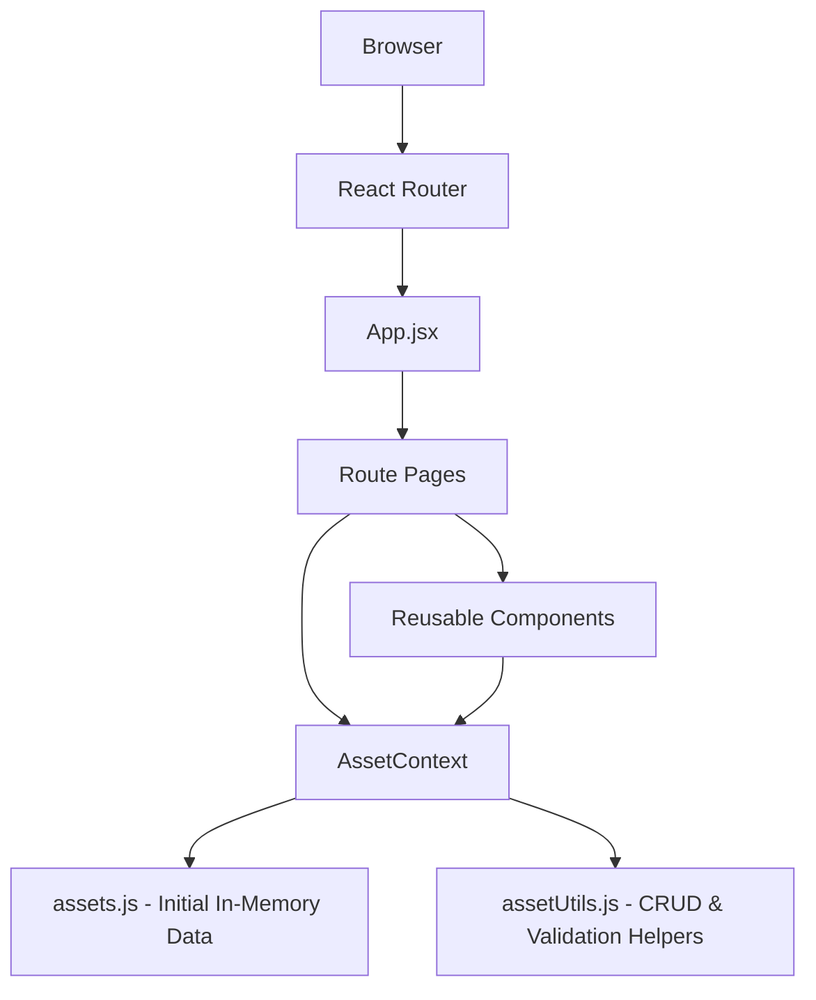

# AssetTrack — Architecture, Technology Stack, and Features

## 1. Architecture Overview
AssetTrack uses a component-based React architecture with client-side routing and shared state through React Context.



Part 1 has **no backend and no database**. Asset records are initialized from `src/data/assets.js` and maintained in React state during the current browser session.

## 2. Component Tree

```text
main.jsx
└── BrowserRouter
    └── AssetProvider
        └── App
            ├── Navbar
            ├── Routes
            │   ├── HomePage → Home
            │   ├── AssetsPage → Assets
            │   ├── AddAssetPage → AssetForm
            │   ├── EditAssetPage → AssetForm
            │   └── AboutPage → About
            └── Footer
```

## 3. State Management
`AssetContext.jsx` is the shared in-memory data layer. It stores the asset collection using `useState` and exposes:

- `assets`
- `addAsset(asset)`
- `updateAsset(asset)`
- `deleteAsset(id)`
- `getAsset(id)`

The context allows pages and components to use the same asset collection without passing state through many levels of props.

## 4. Routing
`react-router-dom` provides client-side routes:

| Route | Purpose |
|---|---|
| `/` | Home dashboard |
| `/assets` | Display/search/filter assets |
| `/assets/add` | Add a new asset |
| `/assets/edit/:id` | Edit an existing asset |
| `/about` | Display team information |

The `Navbar` is visible across the application and uses `NavLink` for navigation.

## 5. Technology Stack

- **React.js** — user interface and components
- **JavaScript (ES modules)** — application logic
- **React Router DOM** — frontend page routing
- **React Context API** — shared in-memory asset state
- **HTML5/CSS3** — structure and responsive visual design
- **Vite** — project scaffolding, development server, and production build
- **Vitest** — test runner
- **React Testing Library** — component testing
- **jsdom** — browser-like test environment
- **Git/GitHub** — version control and public repository sharing
- **AI tools** — support for requirements, design, code, documentation, and testing

## 6. Main Features

- Home dashboard with counts by status
- Navigation menu on all pages
- View all computer assets
- Add computer assets
- Edit existing computer assets
- Delete assets with confirmation
- Search asset records
- Filter by status
- Required-field validation
- Duplicate Asset ID validation
- About page with team information
- Responsive layout

## 7. Testing Architecture
Tests use Vitest and React Testing Library. They cover:

- Asset list rendering
- Search behavior
- Delete behavior
- Form required-field validation
- Duplicate ID validation
- Successful form submission
- `AssetContext` add/update/delete/get operations

Run all tests with:

```bash
npm test
```

## 8. Part 2 Extension
The current `AssetContext` acts as a clean separation point for Part 2. When the Spring Boot backend is introduced, the local state operations can be replaced with HTTP requests to the REST API while the React pages and forms can remain largely unchanged.
